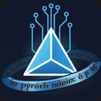

# Prisma

*One plugin to bind them all.* Un solo plugin de [OpenDeck](https://github.com/nekename/OpenDeck) para los decks de Mars Gaming y sus clones de Mirabox y Ajazz: controla el propio deck (brillo, apagado, fondo, animaciones) y añade acciones para teclas y ruedas: perfiles, audio y música, hora, fecha, meteorología, astronomía, temporizador y Pomodoro.

*English below.*

| Familia | Decks | Controles |
|---|---|---|
| AKP153 / Mirabox 293S | **Mars Gaming MSD-ONE**, Ajazz AKP153, Mirabox HSV293S, Soomfon, Womier D15… | 15 teclas + 3 iconos laterales |
| AKP05 / Mirabox N4 | **Mars Gaming MSD-PRO**, Ajazz AKP05, Mirabox N4, VSDInside N4, Redragon SS552… | 10 teclas, 4 ruedas, pantalla táctil |

Todo lo del plugin (qué hace, instalación, ajustes y cómo compilarlo) está en **[prisma/](prisma/)**. Antes se llamaba MGDC (Mars Gaming Deck Controller) y este repositorio, Mars Gaming Deck Tools.

## Instalación

1. En OpenDeck, desinstala los plugins *Ajazz AKP153 / Mirabox HSV293S* y *Ajazz AKP05 / Mirabox N4* (se pelearían por los decks).
2. Descarga `com.malzar.prisma.sdPlugin.zip` de la última versión en **[Releases](../../releases)**.
3. En OpenDeck: **Plugins → Install from file**, eligiendo el `.zip` sin descomprimir. Reinicia OpenDeck.

## Otros plugins

Funcionan con cualquier deck, así que tienen su propio repositorio:

| Proyecto | Qué es | Licencia |
|---|---|---|
| [LHMonitor fancy](https://github.com/malzar/opendeck-lhmonitor-fancy) | Datos de [Libre Hardware Monitor](https://github.com/LibreHardwareMonitor/LibreHardwareMonitor) en tus teclas: CPU por núcleo, GPU, RAM, discos, red, ventiladores y placa base, rotando entre elementos | MIT |
| [Gestor de packs de iconos](https://github.com/malzar/opendeck-iconpacks) | Instala y desinstala packs de iconos de Stream Deck desde una ventana | MIT |

## Agradecimientos

- [OpenDeck](https://github.com/nekename/OpenDeck), de nekename.
- [mirajazz](https://github.com/4ndv/mirajazz) y [opendeck-akp153](https://github.com/4ndv/opendeck-akp153), de 4ndv.
- [opendeck-akp05](https://github.com/ambiso/opendeck-akp05), de ambiso.
- [ajazz-sdk](https://github.com/mishamyrt/ajazz-sdk), de mishamyrt.

Licencia: GPL-3.0. Los datos, fórmulas y bibliotecas de terceros, con sus licencias, están en [prisma/THIRD_PARTY.md](prisma/THIRD_PARTY.md).

---

## English

**Prisma** is a single [OpenDeck](https://github.com/nekename/OpenDeck) plugin for **Mars Gaming MSD-ONE** and **MSD-PRO** stream decks and their Mirabox / Ajazz clones (AKP153 and AKP05 / N4 families). It drives the deck itself (brightness, screen sleep, day/night brightness following the sun, deck background, startup and shutdown animations) and adds key and dial actions: profiles, media and volume, a music dial, clock, date, weather with rain and official warnings, astronomy (Sun, Moon, planets and stars), timer and Pomodoro. Texts in Spanish and English.

Formerly known as MGDC (Mars Gaming Deck Controller); this repository was Mars Gaming Deck Tools.

Uninstall the *Ajazz AKP153 / Mirabox HSV293S* and *Ajazz AKP05 / Mirabox N4* plugins first, download `com.malzar.prisma.sdPlugin.zip` from **Releases** and install it in OpenDeck with *Plugins → Install from file*. GPL-3.0.

Other plugins of mine that work with any deck: [LHMonitor fancy](https://github.com/malzar/opendeck-lhmonitor-fancy) (Libre Hardware Monitor sensors on your keys) and the [icon pack manager](https://github.com/malzar/opendeck-iconpacks). Both MIT.
