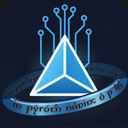

<p align="center"></p>

# Prisma

*One plugin to bind them all.* Un solo plugin de **OpenDeck** para controlar los decks de Mars Gaming y sus clones (antes se llamaba MGDC, Mars Gaming Deck Controller):

| Familia | Decks | Controles |
|---|---|---|
| AKP153 / Mirabox 293S | **Mars Gaming MSD-ONE**, Ajazz AKP153, Mirabox HSV293S, Soomfon, Womier D15… | 15 teclas + 3 iconos laterales |
| AKP05 / Mirabox N4 | **Mars Gaming MSD-PRO**, Ajazz AKP05, Mirabox N4, VSDInside N4, Redragon SS552… | 10 teclas, 4 ruedas, tira táctil |

Sustituye a los plugins *Ajazz AKP153 / Mirabox HSV293S* y *Ajazz AKP05 / Mirabox N4*. **No los tengas instalados a la vez**, porque se pelearían por los decks.

> Estado: **0.9.0**. Novedades: nuevo nombre (Prisma), subperfiles y rueda de perfiles por niveles, hora, fecha y el tiempo (viento, UV, aire, polen, sol y luna) en teclas y ruedas, animaciones en las pantallas de las ruedas, final del cierre con logo o foto, reconexión automática del deck y textos en español e inglés.

## Instalación

1. En OpenDeck, desinstala *Ajazz AKP153 / Mirabox HSV293S* y *Ajazz AKP05 / Mirabox N4*.
2. Plugins → **Install from file** → `com.malzar.prisma.sdPlugin.zip` (sin descomprimir).
3. Reinicia OpenDeck.

### Perfiles

- **MSD-ONE y resto de la familia AKP153:** mantienen sus perfiles, porque se usa el mismo identificador de dispositivo (`99-…`).
- **MSD-PRO y resto de la familia N4:** su identificador pasa de `n4-<serial>` a `99-<serial>`, así que OpenDeck lo verá como un deck nuevo. Para conservar los perfiles, con OpenDeck cerrado y **después de hacer una copia** de `%APPDATA%\opendeck\profiles`, renombra en esa carpeta lo que empiece por `n4-<serial>` a `99-<serial>`. Si algo no carga, restaura la copia y reconfigura el deck.

## Ajustes

En OpenDeck: **Plugins → Prisma → Ajustes del plugin**. Se abre una ventana con los decks conectados y, para cada uno, las pestañas *Pantalla*, *Fondo*, *Iconos*, *Animaciones* e *Información*:

- **Brillo**, que se aplica al momento mientras mueves el deslizador.
- **No apagar nunca la pantalla**, o apagarla tras X minutos sin usar el deck.
- **La pulsación que enciende la pantalla no ejecuta la acción**, para no disparar nada sin querer al despertar el deck.
- **Brillo de día y de noche**:
  - *Según el sol*: amanecer y puesta calculados a diario a partir de la ciudad o las coordenadas, sin internet. Se puede desplazar el cambio unos minutos antes o después.
  - *Horario fijo*: a qué hora empieza el día y a qué hora la noche.
  - Brillo de día, brillo de noche y una transición suave de X minutos.
- **Fondo del deck**: elige una imagen, ajústala (rellenar o encajar, con color de relleno) y pulsa *Aplicar al deck*. Se guarda en la memoria del propio deck, así que se ve también al arrancar y sin OpenDeck. Si un clon lo pinta girado o en espejo, hay una corrección de orientación.
- **Animaciones de arranque y de cierre**:
  - Por pasos: *Lineal*, *Flecha*, *Aleatorio*, *Serpiente*, *Rebote*, *Encuentro*, *Lluvia*, *Molino*, *Cruce* y *Vaivén*. Con estela de 1 a 3 pasos, sin estela o *Fijo* (se quedan encendidas y al final se apaga todo de golpe), opción *Invertir* (de abajo arriba y de derecha a izquierda) y colores de un color, de una paleta o aleatorios.
  - Solo MSD-PRO: ola, tecla a tecla, fundido y GIF propio.
  - En el MSD-ONE se cambian como mucho 4 teclas por envío para que no se atasque; al cerrar siempre deja la imagen de fondo.
  - El cierre se ve al cerrar OpenDeck (al apagar el PC puede no dar tiempo).
- **Paletas**: 10 de serie (Arcoíris, Pastel, Aurora, Atardecer, Océano, Fuego, Synthwave, Hielo, Bosque y Neón) y las que crees tú.
- **Información**: modelo, VID:PID, número de serie, protocolo y pantalla; botones para identificar, reiniciar el deck y copiar los datos.
- **Calibración de iconos**: el firmware puede recortar y desplazar un poco cada icono. Con una imagen de prueba en el deck se ajustan el desplazamiento y el tamaño por zonas: teclas e iconos laterales en el MSD-ONE, teclas y pantalla de las ruedas en el MSD-PRO.
- **Identificar deck**: hace parpadear el deck para saber cuál es.

Los ajustes se guardan en `%APPDATA%\prisma\settings.json` y una copia del último fondo de cada deck en `%APPDATA%\prisma\backgrounds`.

Notas:
- "Apagar la pantalla" pone el brillo a 0, así al despertar no hace falta volver a enviar las imágenes.
- El brillo que pongas desde OpenDeck (por ejemplo con la acción *Device Brightness*) se guarda como brillo del deck. Si el horario de día y noche está activo, manda el horario.

## Audio

En OpenDeck, categoría **Prisma**:

| Acción | Dónde | Qué hace |
|---|---|---|
| Reproducir / Pausa, Detener, Anterior, Siguiente | Teclas | Orden multimedia al reproductor (Spotify, navegador, VLC…), con varios *métodos* a elegir en sus ajustes mientras se prueba cuál llega mejor en segundo plano. Reproducir / Pausa puede mostrar el título, que se lee del nombre de la ventana del reproductor. |
| Subir volumen, Bajar volumen, Silenciar | Teclas | Volumen general o de un programa, con animación al pulsar y el volumen actual debajo. |
| Volumen (rueda) | Ruedas del MSD-PRO | Girar cambia el volumen; pulsar o tocar la pantalla silencia. En su trozo de pantalla: nombre, porcentaje y barra; en el general, también lo que suena. |

En los ajustes de cada acción se elige el destino (*General* primero, luego los programas que están sonando, u *Otro programa…* para escribirlo o elegir su `.exe`), el paso (2 % por defecto) y si se muestra lo que suena.

## Idiomas

Prisma sale en el idioma de OpenDeck (español e inglés; con cualquier otro, en inglés). Todos los textos están en `locales/<idioma>.json`, con una sección por parte:

- `plugin`: lo que se dibuja en teclas y ruedas y los mensajes de error.
- `pi`: las ventanas de ajustes de cada acción.
- `panel`: el panel de Prisma.
- `opendeck`: nombres y descripciones de las acciones en OpenDeck (`package.ps1` genera con ellos los `<idioma>.json` que lee OpenDeck).

En el código solo hay claves (`t("weather.uv.title")`, `T('vistas')`, `data-i18n="…"`). Lo que falte en un idioma sale del inglés y, si tampoco está, del español.

Para añadir un idioma, copia `locales/en.json` como `locales/<código>.json` (`fr`, `de`, `zh_CN`…) y traduce los valores sin tocar las claves. No hace falta compilar: el plugin lee la carpeta `locales` al arrancar. Las pruebas (`cargo test`) comprueban que todos los ficheros tienen las mismas claves y que cada clave que usa el código existe.

## Compilar

Requisitos: [Rust](https://rustup.rs) con las herramientas de compilación de Visual Studio (MSVC).

```powershell
cd mgdc
powershell -ExecutionPolicy Bypass -File .\package.ps1
```

Genera `dist\com.malzar.prisma.sdPlugin.zip`.

### Cómo está organizado el código

Cada cosa en su módulo, y cada módulo partido por responsabilidades (el `mod.rs` de cada carpeta explica qué hay en cada fichero):

- `actions/`: reparte los eventos de OpenDeck. Cada grupo de acciones implementa `ActionGroup` y se apunta en `GROUPS`; para añadir uno no hay que tocar el reparto.
- Grupos de acciones: `audio_actions/` (multimedia y volumen), `profiles/` (rueda de perfiles, teclas virtuales, crear y borrar), `profile_keys.rs` («Entrar / cambiar» y «Perfil actual»), `widgets/` (hora, fecha y tiempo: cada vista del tiempo en su fichero, apuntada en `widgets/weather/mod.rs`) y `timers/` (temporizador y Pomodoro).
- Piezas comunes: `svg.rs` (dibujar), `canvas.rs` (mandar dibujos y respuestas a OpenDeck) y `clicks.rs` (click y doble click).
- El deck: `device.rs`, `family/` (MSD-ONE y MSD-PRO), `animation/` (arranque y cierre: cada animación por pasos en `patterns.rs`), `power.rs`, `schedule.rs`.
- Fuera del deck: `audio/` (Windows, aparte en `audio/win/`), `weather/` (Open-Meteo), `player/` (dibujo del reproductor), `sounds.rs`, `panel/` (el panel de ajustes, con su página en `panel/` de la raíz: `index.html`, `style.css` y el código por apartados en `js/`).

`cargo test` comprueba, entre otras cosas, que cada acción del manifiesto tiene su grupo y que las claves de idioma cuadran. `cargo clippy` no da avisos.

## Configuración de LED y vibración (familia N4)

Se mantiene el `config.toml` del plugin de ambiso. Prisma lo busca en `%APPDATA%\prisma\config.toml` y, si no existe, en `%APPDATA%\opendeck-akp05\config.toml`. El MSD-PRO no tiene LED, así que en la práctica solo sirve para la vibración en los modelos que la tienen.

## Créditos y licencia

GPL-3.0. Basado en:

- [opendeck-akp153](https://github.com/4ndv/opendeck-akp153), de Andrey Viktorov (4ndv), GPL-3.0.
- [opendeck-akp05](https://github.com/ambiso/opendeck-akp05), de ambiso, GPL-3.0.
- [mirajazz](https://github.com/4ndv/mirajazz) (versión de [ambiso](https://github.com/ambiso/mirajazz)), MPL-2.0.
- Protocolo del fondo: [StreamDock-Device-SDK](https://github.com/MiraboxSpace/StreamDock-Device-SDK), de Mirabox.

Datos del tiempo: **Weather data by [Open-Meteo.com](https://open-meteo.com/)**, con licencia [CC BY 4.0](https://creativecommons.org/licenses/by/4.0/). La calidad del aire y el polen vienen de Copernicus (CAMS) y las localidades, de [GeoNames](https://www.geonames.org/) (CC BY 4.0), las dos a través de Open-Meteo. La fase y la posición de la luna usan las fórmulas de [SunCalc](https://github.com/mourner/suncalc) (BSD de 2 cláusulas).

Todo lo que es de terceros (datos, código, fórmulas, bibliotecas y webs enlazadas), con su licencia y lo que pide cada una, está en [THIRD_PARTY.md](THIRD_PARTY.md).
